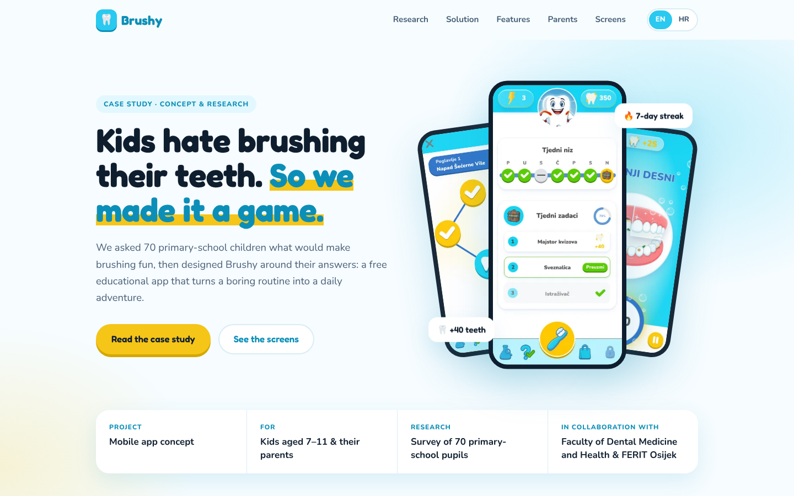
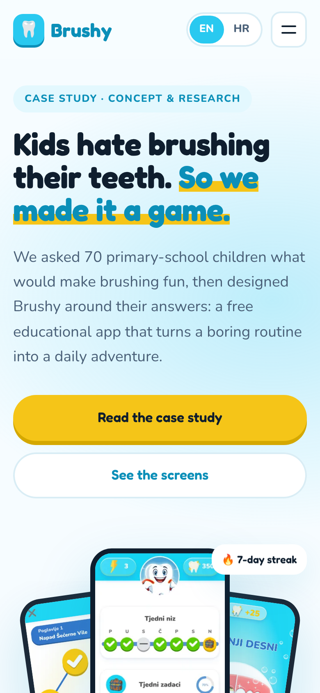

<h1 align="center">Brushy</h1>

A case study website for Brushy, a mobile app concept that turns kids' toothbrushing into a game. The concept came out of a research project between the Faculty of Dental Medicine and Health Osijek and FERIT Osijek, where we surveyed 70 primary-school children about why they skip brushing and what would make it fun. The website presents that research, the insights behind the design, and the app's screens, in both English and Croatian.

## Links

- [Repo](https://github.com/marinsabo/Brushy "Brushy Repo")
- [Live](https://marinsabo.github.io/Brushy/ "Live View")

## Screenshots

## Built With

- HTML5
- CSS3
- JavaScript

## AI Usage

I used generative AI as a support tool in this project:

- redesigning the page as a case study and adding the English/Croatian language switch, which I reviewed and tested before publishing
- drafting the page copy, which I then reviewed and edited
